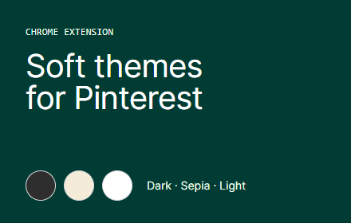
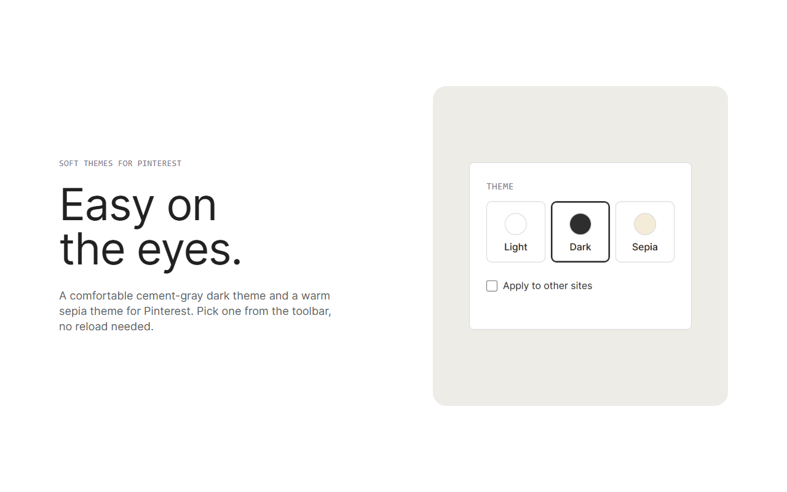

# Pinterest Dark Mode — Soft Themes for Pinterest (Chrome extension)

🌐 [Website](https://renanerss.github.io/Pinterest-Dark-Mode/) · 🇧🇷 [Leia em português](README.pt-BR.md)

**Pinterest dark mode** that is easy on the eyes. Pinterest is bright; this free Chrome extension adds a soft dark theme and a sepia theme, switchable in one click:

- **Dark**: a soft **cement-gray** background (never pure black) with comfortable contrast.
- **Sepia**: a warm paper tone for long sessions.
- **Light**: Pinterest as it comes.

Your pins keep their original colors: the themes change the page, never the photos.

## Install (from the .zip)

Chrome can't install a `.zip` directly, so you unzip it once and load the folder. It takes about a minute.

1. **[Download the .zip](https://github.com/renanerss/Pinterest-Dark-Mode/raw/main/releases/soft-themes-for-pinterest-1.0.0.zip)**.
2. **Unzip** it into a folder you'll keep (for example `Documents/soft-themes-for-pinterest`). Chrome loads the extension from that folder, so don't delete it afterwards. You should see `manifest.json` directly inside it.
3. Open `chrome://extensions` and turn on **Developer mode** (top-right).
4. Click **Load unpacked** and select the folder from step 2.
5. Click the puzzle icon in the toolbar and **pin** the extension. Pick a theme.

Pinterest tabs that were already open need one refresh (F5) the first time.

**Updating:** download the new `.zip`, unzip it over the same folder, then click the reload icon on the extension's card in `chrome://extensions`.

### Windows Defender says the .zip is a threat?

Some Windows Defender versions flagged this download as `Trojan:Script/Ulthar.A!ml`. The `!ml` suffix means a machine-learning *guess*, not a known-malware signature, and here it is a **false positive**: the extension makes no network requests, has no obfuscated code, and its entire source is in this repository. The current .zip scanned clean with Defender on the maintainer's PC, but heuristics change over time.

You can check it yourself:

- **Compare the hash.** In PowerShell: `Get-FileHash .soft-themes-for-pinterest-1.0.0.zip -Algorithm SHA256`. It must match [releases/SHA256.txt](releases/SHA256.txt) (`92c555783a4a8732f487c1bca529ce2beb621528832f81696e2de52b96ac97bb`).
- **Read the code.** It's small and plain JavaScript/CSS, browsable right here on GitHub.
- **Report the false positive** to Microsoft so the detection gets fixed: https://www.microsoft.com/en-us/wdsi/filesubmission

If the hash doesn't match, don't install it, and please [open an issue](https://github.com/renanerss/Pinterest-Dark-Mode/issues).

Works in Chrome and in Chromium-based browsers (confirmed in Brave; Edge and others should work the same way, using `edge://extensions`).

## Using it

- Click the toolbar icon and choose **Light**, **Dark** or **Sepia**. Open tabs update right away.
- **Apply to other sites** (optional, off by default): applies the same look to other websites. Your browser asks for permission when you turn it on, and the permission is removed when you turn it off.
- The interface comes in **55 languages** and follows your browser's language automatically.

## Privacy

No data is collected, sold or sent anywhere. Your choices are saved with `chrome.storage.sync` (synced by your own Google account, if you use Chrome sync). No analytics, no ads, no remote code. Details: [privacy policy](docs/store/privacy-policy.md).

## FAQ

**Why does "Apply to other sites" ask for permission?** Because it needs access to the sites you visit in order to change their colors. The extension doesn't ask for that at install; it only asks if you turn the option on.

**Pinterest looks wrong in some page.** Pinterest changes its site often. Please [open an issue](https://github.com/renanerss/Pinterest-Dark-Mode/issues) saying which page and which theme (a screenshot helps).

**Is it on the Chrome Web Store?** Not yet. Until then, use the install steps above.

## Support the project

The extension is free and independent. If it makes Pinterest nicer for you, you can [buy me a coffee](https://buymeacoffee.com/renanerslif) ☕. It's optional and always appreciated.

## Disclaimer

Not affiliated with, endorsed by or sponsored by Pinterest. Pinterest is a trademark of Pinterest, Inc.

## For developers

Build, tests and release instructions are in [docs/DEVELOPMENT.md](docs/DEVELOPMENT.md). Version history: [CHANGELOG.md](CHANGELOG.md).
